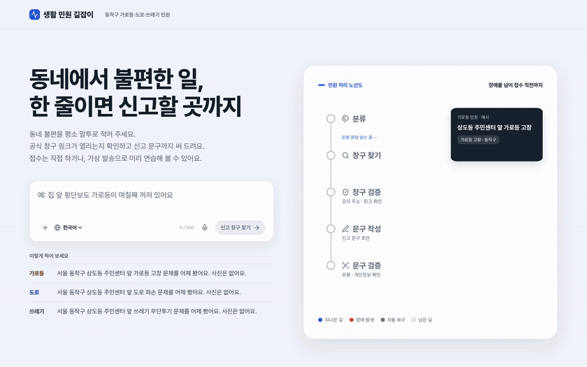
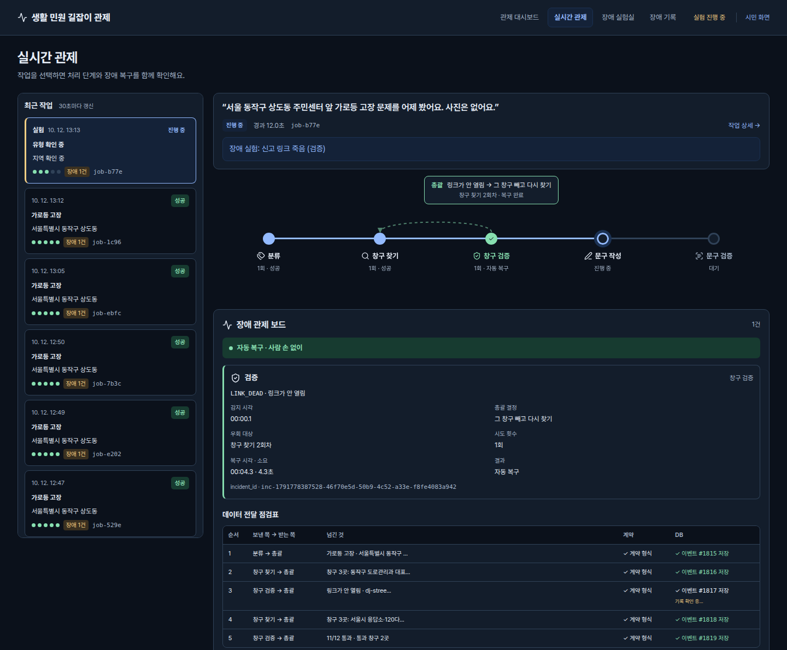
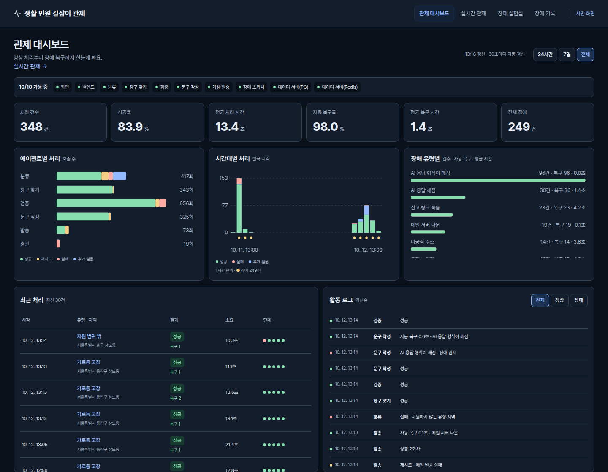

# 생활 민원 길잡이

동네에서 불편한 일을 한 줄로 적으면, **어디에 신고해야 하는지 공식 창구를 찾아 주고 바로 낼 신고 문구까지 써 주는** 웹 서비스입니다.
중간에 AI 답이 깨지거나 신고 링크가 죽어 있어도 에이전트들이 이를 알아채고 다시 시도하거나 다른 길로 돌아가 **스스로 복구합니다(오토힐링)**. 정해진 횟수 안에 안 되면 확인된 데까지만 "확인 필요" 표시와 함께 안내합니다. 민원 안내는 틀린 링크 하나로 헛걸음이 되기 때문에, "오류가 났습니다"로 끝나지 않는 것이 이 서비스의 핵심입니다.

화면은 둘로 나뉩니다. 주민이 민원을 넣고 안내를 받는 **시민 화면**(`/`)과, 운영자가 처리 현황과 장애·복구 과정을 지켜보는 **관리자 화면**(`/admin/`)입니다. 민원은 글뿐 아니라 말(음성)로도 넣을 수 있고, 사진 첨부와 외국어(영어·일본어·중국어·베트남어) 입력도 됩니다. 신고 메일은 실제 기관이 아니라 시연용 가상 담당자 메일함으로만 갑니다.

> 4팀 · 멀티 에이전트 협업 및 서비스 운영 프로젝트 · 범위: 서울 동작구 · 가로등 고장 · 도로 파손 · 쓰레기 무단투기



| 관리자 화면 실시간 관제: 어디서 실패했고 어디로 돌아갔는지 | 관리자 화면 관제 대시보드: 처리부터 장애 복구까지 한 화면에 |
|---|---|
|  |  |

관제 대시보드 숫자는 서버 DB에 쌓인 기록 전체(장애 시험·실제 AI 오류·시연 질문 포함)라서, 아래 실측 결과(장애 시험 110회만 따로 잰 값)와 다릅니다.

> **실측 결과**: 배포된 서버에 장애 10가지를 110번 일부러 냈습니다. 한 번씩 낸 장애 95번은 모두 사람 손 없이 처리됐고(복구 85번 + 공격 문구 차단 10번, 이 95번의 평균 처리 시간 7.12초), 같은 장애를 3번 연속 낸 스트레스 시험 15번은 재시도 한도를 다 써서 실패했습니다. 전체 자동 복구율은 86.36%입니다. 자세한 표는 [배포 및 장애 복구 보고서](docs/reports/deploy_and_recovery.md)에 있습니다.

## 접속 주소

- 시연 계정 로그인(버튼 한 번): 상단 **로그인**을 누르면 김민원 계정으로 메일을 보내고 내 메일함에서 회신을 확인할 수 있습니다.

| 무엇 | 주소 | 비고 |
|---|---|---|
| 시민 화면 | https://13-125-206-154.sslip.io | 누구나 접속할 수 있습니다. http://13.125.206.154:8501 로도 열리지만 마이크 입력은 https에서만 됩니다 |
| 관리자 화면 | https://13-125-206-154.sslip.io/admin/ | 처리 현황 숫자(관제 대시보드), 진행 중인 작업과 장애 복구 과정(실시간 관제), 장애를 일부러 내 보는 장애 실험실, 장애 기록 |
| 가상 담당자 메일함 | https://13-125-206-154.sslip.io/mailbox/ | "담당자에게 보내기(가상)"로 보낸 메일과 접수 회신 |
| 백엔드 API | 앱 서버 내부 8000번 | 밖으로 열지 않고 화면이 `/api`로 대신 부릅니다 |
| 데이터 서버 | PostgreSQL 5433 · Redis 6379 | 앱 서버에서만 접속할 수 있습니다. 내 컴퓨터에서 실행하면 PostgreSQL은 5432입니다 |

## 바로 실행 (내 컴퓨터)

Docker만 있으면 됩니다. PostgreSQL·Redis까지 한 번에 뜹니다.

```bash
git clone https://github.com/encore-ai-campus/aio-01-p3-team4.git
cd aio-01-p3-team4
cp .env.example .env            # OPENAI_API_KEY 한 줄만 채웁니다(비워도 실행됨)
docker compose up --build --wait
```

- 시민 화면 http://localhost:8501 에서 예시 질문 버튼을 누르면 됩니다. 관리자 화면은 http://localhost:8501/admin/ , API 문서는 http://localhost:8000/docs 입니다.
- 끌 때는 `docker compose down`을 실행합니다.

## 필요한 값 (`.env`)

| 이름 | 꼭 필요한가 | 용도 |
|---|---|---|
| `OPENAI_API_KEY` | 권장 | 분류·문구 작성에 쓰는 AI 키입니다. 비워 두면 AI 없이 규칙·템플릿으로만 결과를 냅니다 |
| `OPENAI_MODEL`, `OPENAI_FALLBACK_MODEL` | 아니요 | 기본 모델과, 답이 깨졌을 때 바꿔 쓰는 대체 모델 |
| `KAKAO_REST_KEY` | 아니요 | 말한 장소가 실제로 어느 지역인지 카카오로 확인합니다. 비워 두면 함께 들어 있는 역 데이터로만 확인합니다 |
| `COMPOSE_PROFILES` | 아니요 | `local`이면 PostgreSQL·Redis를 같이 띄웁니다. 서버에서는 비웁니다 |
| `DATABASE_URL`, `REDIS_URL` | 서버에서만 | 데이터 서버 주소 |
| `FRONTEND_BIND` | 서버에서만 | `0.0.0.0`이면 밖에서 화면에 접속할 수 있습니다 |
| `ADMIN_GATE`, `ADMIN_USER`, `ADMIN_PASS` | 아니요 | 관리자 화면 잠금. 아래 "관리자 화면 잠그기"를 봅니다 |

### 관리자 화면 잠그기

기본은 잠금 없이 열려 있습니다. `.env`에 `ADMIN_GATE=on`, `ADMIN_USER=<아이디>`, `ADMIN_PASS=<비밀번호>`를 넣고 `docker compose up -d frontend`로 다시 띄우면, `/admin/`에 들어갈 때 브라우저가 아이디와 비밀번호를 묻는 창을 띄웁니다. 화면을 여는 것만 막는 간단한 잠금이고 시민 화면에는 영향이 없습니다. `ADMIN_GATE=on`인데 비밀번호가 비어 있으면 frontend가 뜨지 않습니다.

## 문제 해결

| 증상 | 해결 |
|---|---|
| `port is already allocated` | 5432·6379·8000번대를 쓰는 다른 컨테이너를 멈추거나 `.env`에서 포트를 바꿉니다 |
| 화면은 뜨는데 결과가 안 나옴 | `docker compose ps`로 unhealthy인 서비스를 찾고 `docker compose logs backend`를 봅니다 |
| 메일함이 비어 있음 | `docker compose ps mailpit`으로 메일 서버가 떠 있는지 봅니다 |
| Windows에서 `cp`가 안 됨 | PowerShell에서는 `Copy-Item .env.example .env` 입니다 |

## 문서

| 문서 | 내용 |
|---|---|
| [멀티 에이전트 설계서](docs/DESIGN.md) | 왜 에이전트로 나눴나, 흐름, 주고받는 약속, 실패 코드와 복구 길 |
| [배포 및 장애 복구 보고서](docs/reports/deploy_and_recovery.md) | 서버 구성, 장애 시험 방법, 실측 자동 복구율·복구시간 |
| [파이프라인(CI/CD) 구현 결과 보고서](docs/reports/cicd.md) | 서비스별 자동 테스트·배포·알림, 실제 실행 기록 |

## 팀

| 이름 | 맡은 것 |
|---|---|
| 오병훈 (팀장) | 총괄(백엔드), DB, 복구 지표 |
| 문태웅 | 화면, 검증 에이전트, 가상 발송 에이전트, 계약 관리, 최종 연결 |
| 이원민 | 장애 스위치, 실행 환경, CI/CD·배포 |
| 최강현 | 창구 찾기 에이전트, 동작구 공식 창구 데이터, 링크 점검 |
| 한태경 | 분류·문구 작성 에이전트, 데이터 서버 |
