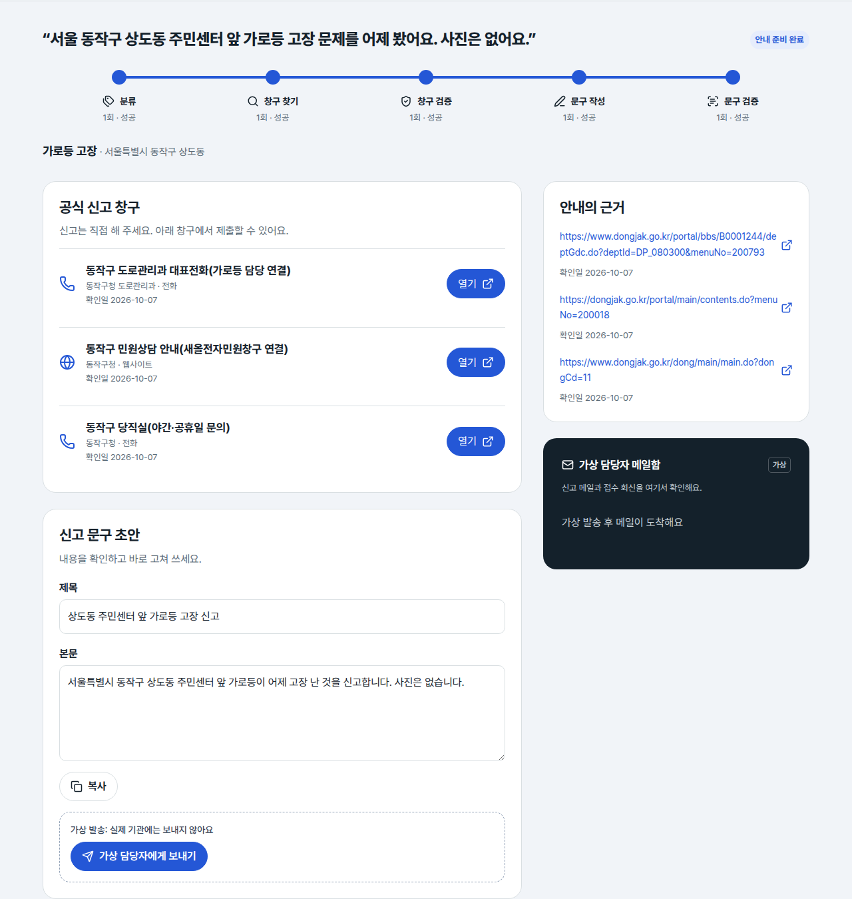
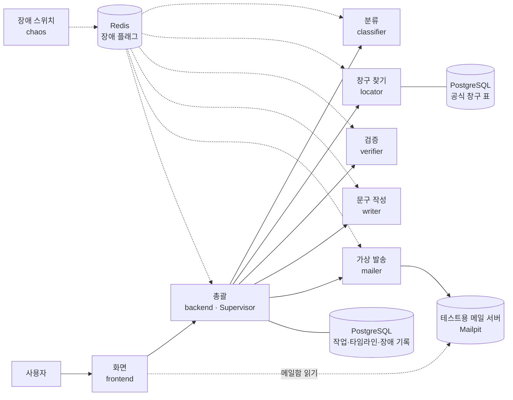
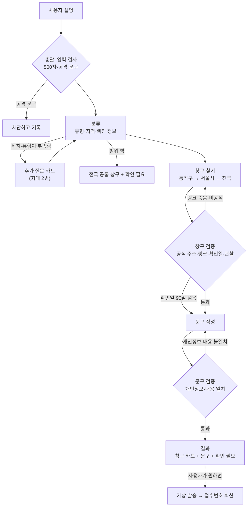
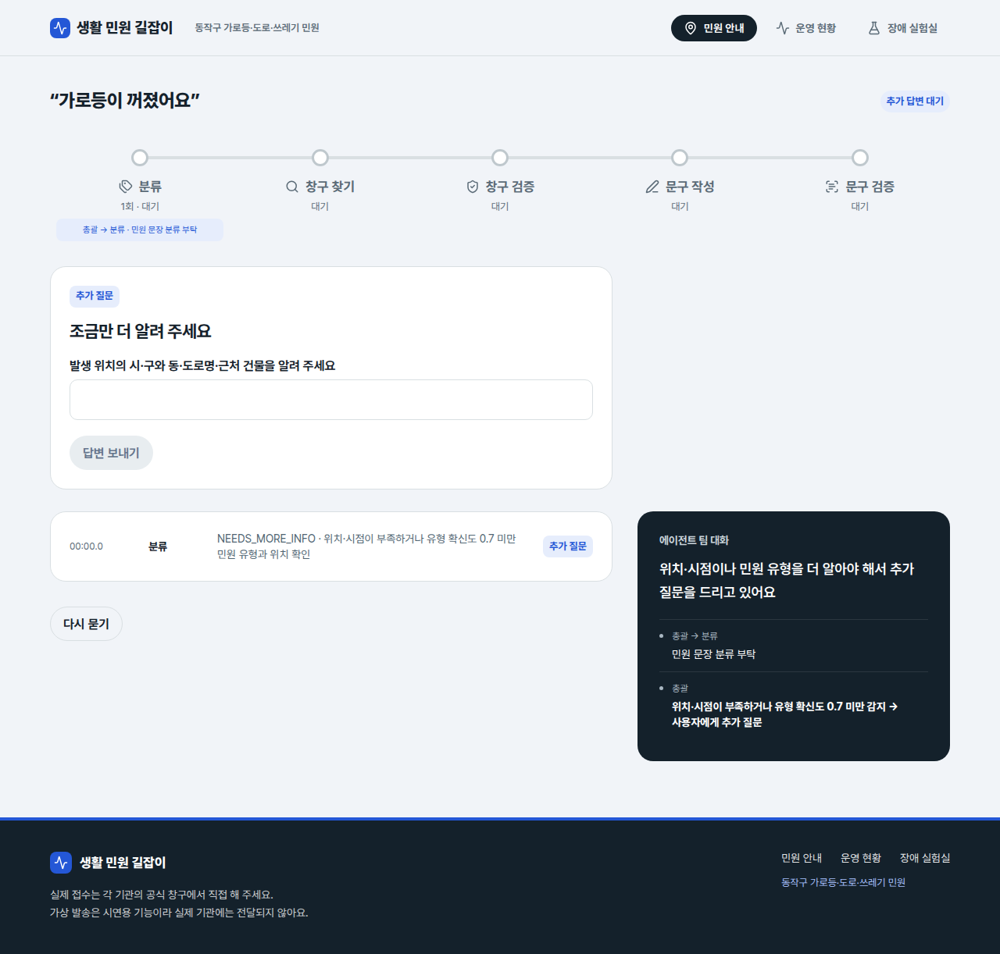
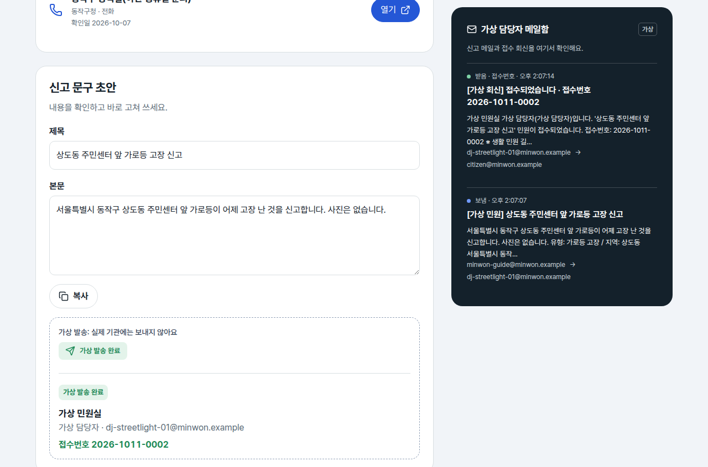
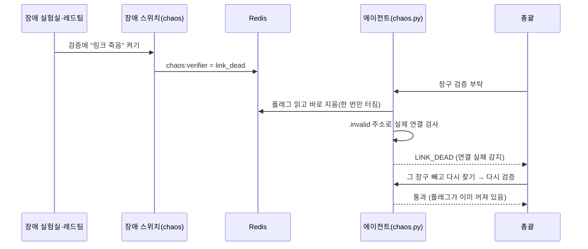

# 멀티 에이전트 설계서 — 생활 민원 길잡이

이 문서는 **어떤 일을 왜 여러 에이전트로 나눴는지, 에이전트들이 무엇을 주고받는지, 장애가 나면 어떤 길로 스스로 복구하는지**를 설명합니다.
처음이면 1~4절만 읽어도 전체 그림이 잡힙니다. 서버 구성과 실측 복구율은 [배포 및 장애 복구 보고서](reports/deploy_and_recovery.md)에 있습니다.

## 1. 한 줄 요약

시민이 겪은 불편을 평소 말투로 적으면, 에이전트 팀이 **민원 유형과 지역을 파악하고, 공식 신고 창구를 찾고, 그 근거를 검증한 뒤, 신고 문구 초안**까지 만들어 줍니다. 실제 제출은 사용자가 공식 창구에서 직접 합니다.

| 입력 | 결과 |
|---|---|
| "상도동 주민센터 앞 횡단보도 가로등이 며칠째 꺼져 있어요" | 유형 **가로등 고장** · 지역 **서울 동작구** / 공식 신고 창구 카드(링크·확인일) / 바로 고쳐 쓸 수 있는 신고 문구 / 헷갈리는 부분은 **확인 필요** 표시 |

- 범위: **서울 동작구**, 민원 3종(가로등 고장 · 도로 파손 · 쓰레기 무단투기). 그 밖의 유형·지역은 "지원 범위 밖"으로 안내하고 전국 공통 창구를 알려 줍니다.
- 원하면 확인한 문구를 **가상 담당자에게 메일로 보내고 접수번호 회신**을 받습니다. 테스트용 메일 서버(Mailpit)로만 가는 시연용 가상 발송이라 실제 기관에는 가지 않습니다.

## 2. 왜 여러 에이전트로 나눴나

민원 안내는 **틀린 링크 하나, 관할 착오 하나**면 사용자가 헛걸음합니다. 그래서 "오류가 났습니다"로 끝나면 안 되고, 확인된 다른 길로라도 끝까지 안내해야 합니다. 이 일을 한 덩어리 프로그램이 아니라 에이전트 여러 개로 나눈 이유는 네 가지입니다.

| 이유 | 설명 |
|---|---|
| 일마다 고장 나는 방식이 다릅니다 | AI 답은 모양이 깨지고, 신고 링크는 죽고, 문구에는 개인정보가 섞입니다. 단계를 나누면 **어디서 무엇이 고장 났는지** 정확히 알고, 그 단계만 다시 하거나 다른 길로 보낼 수 있습니다 |
| 만드는 쪽과 검사하는 쪽을 나눴습니다 | 창구를 찾는 에이전트와 문구를 쓰는 에이전트가 자기 결과를 스스로 통과시키지 않도록, **검증 에이전트가 따로** 링크를 열어 보고 개인정보를 검사합니다 |
| 하나가 죽어도 나머지는 삽니다 | 에이전트마다 컨테이너가 따로라 한 서비스가 꺼져도 다른 서비스는 그대로이고, 총괄이 그 단계를 다시 시도합니다. 배포도 서비스별로 따로 합니다 |
| 다섯 명이 동시에 만들 수 있습니다 | 주고받는 데이터 모양(계약)만 먼저 정해 두고 각자 자기 에이전트를 샘플 입력으로 따로 개발했습니다 |

## 3. 전체 구조

- 에이전트는 모두 FastAPI 서버(`/health` + `POST /run`)이고, 총괄은 화면용 API(`/jobs` 등)를 엽니다. 화면만 React + nginx입니다. 에이전트끼리는 서로를 부르지 않고 **총괄만 에이전트를 부릅니다.** 이렇게 한 에이전트가 일을 나눠 주고 결과를 모으는 구조를 Supervisor 방식이라고 부릅니다.
- 그림의 점선은 장애 실험용 연결입니다. 장애 스위치가 Redis에 장애 플래그를 써 두면, 각 서비스가 일하기 직전에 그 플래그를 읽습니다.
- 서비스 8개와 Mailpit은 앱 서버 한 대, PostgreSQL·Redis는 데이터 서버에서 돌아갑니다. 나눈 이유는 [배포 및 장애 복구 보고서](reports/deploy_and_recovery.md#2-서버-구성-앱-서버와-데이터-서버를-나눈-이유)에 있습니다.

**AI는 필요한 곳에만 씁니다.** 민원을 처리하는 길에서는 사람 말을 이해하고 문장을 쓰는 두 에이전트만 OpenAI 모델을 부르고, 나머지는 규칙·DB·실제 링크 확인으로 일합니다(장애 실험에서 AI가 낼 장애를 고르는 '레드팀' 기능도 AI를 씁니다). 그래서 AI가 틀려도 그 결과를 AI가 아닌 쪽이 검사할 수 있습니다.

| 에이전트 | AI 사용 | 방법 |
|---|---|---|
| 분류 · 문구 작성 | 예 | 기본 모델(`gpt-6-luna`)이 안 되면 대체 모델(`gpt-5.4-mini`), 그래도 안 되면 규칙·템플릿. 모델 이름은 `.env`로 바꿀 수 있습니다 |
| 장애 스위치의 레드팀 | 예 | 기본 모델 하나로 "지금 어떤 장애를 켤지"만 고릅니다 |
| 총괄 · 창구 찾기 · 검증 · 가상 발송 | 아니요 | 규칙(공격 문구 검사·개인정보 패턴), DB 조회, 링크를 직접 열어 보기, 메일 발송 |

## 4. 일이 흘러가는 순서

1. **총괄**이 입력을 먼저 검사합니다. 500자를 넘거나 공격 문구가 섞였으면 에이전트를 부르지 않고 막습니다.
2. **분류**가 유형·지역·빠진 정보를 판단합니다. 동작구 안의 구체적인 위치가 없거나 유형 확신도가 0.7 미만이면 사용자에게 추가 질문을 띄웁니다(발생 시점·사진 유무는 없어도 묻지 않습니다). AI가 정리한 지역 이름은 사용자 입력에 실제로 있는 것만 받아들여서, AI가 "집 앞"을 보고 동네를 지어내는 일을 막습니다. 장소 이름은 지도 API로 실제 위치를 확인해서, 말한 지역과 어긋나면 되묻고 지역을 안 말했으면 장소 기준으로 지역을 정합니다. 동 이름도 지도 주소 검색으로 관할을 확인합니다. 위치·유형이 빠졌거나 어긋나서 되묻는 것은 모두 같은 추가 질문 카드로 하며, 처리 도중 멈추고 사람에게 묻는 건 이 카드 하나뿐입니다. 두 번 물어도 부족하면 "확인 필요"를 붙여 상위 창구로 안내합니다.
3. **창구 찾기**가 DB의 공식 창구 표에서 최대 3개를 찾습니다. 동작구에 없으면 서울시, 그다음 전국 공통 창구로 한 단계씩 올라갑니다. 동작구 안의 민원이면 그 동의 주민센터를 최대 2곳 더 붙입니다. 창구 데이터는 최강현이 직접 조사한 14곳(동작구 6 · 서울시 5 · 전국 3, 웹 8곳 · 전화 6곳)과 동작구 동 주민센터 15곳입니다.
4. **검증**이 창구를 검사합니다. 주소가 공식 도메인(`go.kr`·`gov.kr`·`120dasan.or.kr`)인지, 링크가 실제로 열리는지(5초 안에 응답), 확인일이 90일 이내인지, 관할·유형이 맞는지 봅니다. 전화 창구는 번호 모양과, 그 번호가 실린 공식 안내 페이지가 열리는지를 봅니다. 링크가 죽었거나 공식 주소가 아니면 그 창구를 빼고 다시 찾게 합니다.
5. **문구 작성**이 신고 제목·본문·사용자가 채울 칸을 씁니다. 전화번호·주민등록번호·이메일·집 동·호수 같은 개인정보는 AI에 넘기기 전과 받은 뒤에 스스로 지우고, **검증**이 개인정보와 유형·지역이 맞는지를 한 번 더 봅니다.
6. 결과를 화면에 보여 줍니다. 사용자가 [보내기]를 누르면 **가상 발송**이 가상 담당자에게 메일을 보내고, 몇 초 뒤 가상 담당자의 접수번호 회신이 메일함에 도착합니다.

| 위치가 빠지면 추가 질문(처리 중 사람에게 묻는 유일한 장면) | 가상 발송과 가상 담당자의 접수번호 회신 |
|---|---|
|  |  |

### 복수 민원 병렬 처리

한 설명에 지원 유형이 여러 개면 유형을 되묻지 않고 첫 유형으로 시작합니다. 총괄이 나머지 유형을 고정해 다시 분류하고, 창구 찾기부터 문구 검증까지 유형별로 병렬 실행합니다.
결과는 유형별 탭으로 보여 주며 초안과 가상 발송을 각각 관리합니다. 화면이 원래 읽던 결과 자리(`result`)에는 첫 유형의 결과를 그대로 넣고, 한 유형이라도 안내를 마치면 성공으로 처리합니다.

### 음성·사진·외국어 입력

질문은 글 말고도 세 가지 방법으로 넣을 수 있습니다. 서버 계약은 그대로 두고 화면과 총괄 앞단에서만 처리합니다.

- **음성**: 입력칸 옆 마이크 버튼을 누르고 말하면 브라우저 음성 인식(Web Speech API)이 글로 옮깁니다. 서버로 소리를 보내지 않고, 인식을 지원하지 않는 브라우저에서는 버튼이 보이지 않습니다. 브라우저가 https에서만 마이크를 허용하므로 https 주소로 접속해야 합니다.
- **사진**: 한 장을 고를 수 있지만 파일은 브라우저에만 두고, 서버에는 사진이 있다는 표시(`has_photo`)만 보냅니다. 분류는 사진 유무를 다시 묻지 않고, 문구 작성은 초안에 "사진이 있다"는 문장을 넣습니다. 가상 발송 메일에는 사진이 담기지 않으므로 결과 화면에서 실제 접수 때 직접 첨부하라고 안내합니다.
- **외국어**: 영어·일본어·중국어·베트남어를 고르면 총괄이 설명과 답변을 한국어로 번역해 기존 흐름 그대로 처리합니다. 추가 질문·창구 이름·초안 미리보기는 고른 언어로 보여 주고, 실제로 보내는 초안은 한국어 그대로 둡니다. 번역에 실패하면 원문으로 처리하고 안내를 한 줄 띄웁니다.

### 사람 수정 문구 재검증

사용자가 초안을 고치면 보내기 전에 문제 구간과 이유를 보여 주고, 개별 또는 전체 수정 후 자동으로 다시 검토합니다.
개인정보·비공식 링크는 반드시 고쳐야 하며, 장소·숫자·유형 변경 경고는 확인하고 보낼 수 있습니다. 검증 에이전트가 2초 안에 답하지 않으면 규칙 검사로 넘어가고, 발송 API에서도 차단 규칙을 한 번 더 확인합니다.

## 5. 에이전트 역할

| 에이전트 | 하는 일 | 하지 않는 일 | 담당 |
|---|---|---|---|
| 총괄 (backend) | 순서 정하기, 실패 코드에 맞춰 다시 시키기·다른 길 고르기, 타임라인·장애 기록, 공격 문구 차단, 복구 지표 계산 | 직접 분류·검증·작성 | 오병훈 |
| 분류 (classifier) | 유형·지역·빠진 정보 판단, 추가 질문 문장, 말한 장소가 실제로 그 지역인지 확인(카카오 장소 검색, 없으면 역 데이터) | 확신도 0.7 미만이면 유형을 단정하지 않음 | 한태경 |
| 창구 찾기 (locator) | 공식 창구 최대 3개(동작구면 동 주민센터 최대 2곳 추가), 없으면 한 단계 위 지역 | 링크 진위 판단(검증에 넘김) | 최강현 |
| 검증 (verifier) | 창구: 공식 도메인·링크 생존·확인일 90일·관할 / 문구: 개인정보·내용 일치 → PASS·RETRY·FAIL | 결과를 직접 고치지 않음 | 문태웅 |
| 문구 작성 (writer) | 신고 제목·본문, 사용자가 채울 칸 | 개인정보를 묻거나 넣지 않음 | 한태경 |
| 가상 발송 (mailer) | 확인된 문구를 가상 담당자에게 발송, 접수번호 자동 회신, 메일 서버 장애 시 다시 보내기 | 실제 기관 주소로 발송(`.example` 주소가 아니면 코드가 거부) | 문태웅 |
| 장애 스위치 (chaos) | 장애 켜기·끄기, 레드팀(AI가 어떤 장애를 켤지 고름) | 실제 공공기관 사이트에 장애를 넣지 않음 | 이원민 |

- 지원 범위 밖 민원은 맨 위에 “안내만” 표시를 띄우고 실제 수행한 단계만 보여 주며, 문구 작성·문구 검증·발송은 하지 않습니다.
- 시연 로그인은 버튼 한 번으로 시연용 가상 주민 계정(김민원)에 들어가고, 사이트에서 메일을 보낸 뒤 내 메일함에서 보낸 민원과 받은 회신을 확인합니다.

화면(frontend, 문태웅)은 보는 사람에 따라 두 사이트로 나뉩니다. 컨테이너 하나의 nginx가 `/`와 `/admin/`을 함께 서빙합니다.

| 사이트 | 보는 사람 | 담는 것 |
|---|---|---|
| 시민 화면 `/` | 민원을 넣는 주민 | 질문 입력(글·음성·사진·외국어), 진행 노선도, 추가 질문, 결과의 창구 카드·문구 수정·복사·가상 발송. 장애는 실패 코드 없이 "다른 길로 확인 중" 정도로만 알립니다 |
| 관리자 화면 `/admin/` | 운영자·발표 시연 | 관제 대시보드(처리 숫자·서비스 상태), 실시간 관제(어느 에이전트·단계에서 실패했는지, 어디로 우회했는지, 복구와 데이터 전달 점검표), 장애 실험실, 장애 기록 |

실행 환경·CI/CD는 이원민, 데이터 서버는 한태경, 창구 데이터와 링크 점검 스크립트는 최강현이 맡았습니다.

## 6. 주고받는 약속 (계약)

에이전트끼리는 미리 정한 JSON 모양으로만 주고받습니다. 스키마와 단계별 샘플 입력·출력은 [`contracts/`](../contracts/)에 있고, 각 에이전트는 이 샘플만으로 혼자 개발·테스트했습니다.

| 방향 | 모양 |
|---|---|
| 총괄 → 에이전트 (`POST /run`) | `{task_id, from, to, objective, inputs, constraints, attempt, last_failure, memory_refs}` |
| 에이전트 → 총괄 | `{task_id, author, status, data, failure, incident_id}` |

- `status`는 네 가지뿐입니다: `success`(성공) · `retry`(다시 해 볼 만함) · `failed`(이 방법은 안 됨) · `needs_user`(사람에게 물어야 함).
- 실패하면 `failure`에 아래 7절 표의 코드 하나만 넣습니다. 표에 없는 코드는 쓰지 않습니다.
- 여러 단계가 같이 쓰는 모양도 고정했습니다. 지역 `{sido, sigungu, dong, place_text}`, 유형 `streetlight`·`road_damage`·`illegal_dumping`·`out_of_scope`, 창구 `{channel_id, name, org, method, url, jurisdiction, verified_at, source_url}`.

| 단계 | 받는 것 (`inputs`) | 돌려주는 것 (`data`) |
|---|---|---|
| 분류 | `text`, (추가 질문 답) `answers` | `category`, `confidence`, `region`, `details`, `missing`, `questions` |
| 창구 찾기 | `category`, `region`, `exclude_channel_ids` | `channels`(일반 창구 최대 3개 + 동 주민센터 최대 2곳), `fallback_level`(찾은 단계: district 동작구·city 서울시·national 전국) |
| 검증 | `mode`(channel·draft), `category`, `region`, `channels` 또는 `draft` | `verdict`(PASS·RETRY·FAIL), `checks`, `reasons`, `passed_channel_ids` |
| 문구 작성 | `category`, `region`, `details`, `channel` | `title`, `body`, `fill_in`, `removed_pii` |
| 가상 발송 | `category`, `region`, `channel`, `draft` | `message_id`, `to`, `status`(sent·queued·blocked), `receipt_no`, `attempts` |

화면이 쓰는 총괄 API: `POST /jobs`(질문 접수) · `GET /jobs/{id}`(상태·결과) · `GET /jobs/{id}/timeline`(진행 기록) · `POST /jobs/{id}/answers`(추가 질문 답) · `POST /jobs/{id}/review`(고친 문구 첨삭) · `POST /jobs/{id}/send`(가상 발송) · `GET /ops/overview`(관제 대시보드 한 화면 묶음) · `GET /metrics` · `GET /incidents` · `/chaos/*`(장애 스위치로 전달).

`POST /jobs`와 `POST /jobs/{id}/answers`는 접수만 하고 바로 `running`을 돌려준 뒤, 총괄이 뒤에서 에이전트를 차례로 부릅니다. 화면은 `GET /jobs/{id}`와 `/timeline`을 1초마다 다시 읽어 단계가 바뀌는 대로 보여 주므로, 질문을 넣자마자 첫 단계가 움직이고 경과 시간이 올라갑니다. 결과를 한 번에 받아야 하는 시험 스크립트는 `?wait=true`를 붙입니다. 그러면 처리가 끝날 때까지 기다렸다가 결과를 돌려줍니다.

## 7. 실패 코드와 복구 길

| 코드 | 누가 냄 | status | 뜻 | 총괄이 하는 일 |
|---|---|---|---|---|
| LLM_OUTPUT_INVALID | 분류·작성 | retry | AI 답 모양이 깨짐 | 보통은 에이전트가 안에서 대체 모델·규칙으로 먼저 복구하고 그 기록을 남김. retry로 돌아오면 같은 단계 다시 시도 |
| SERVICE_UNAVAILABLE | 총괄 | retry | 에이전트가 응답 없음(15초 초과 포함) | 3초, 6초 기다렸다가 같은 단계 다시 시도 |
| NEEDS_MORE_INFO | 분류 | needs_user | 위치 부족, 유형 확신도 0.7 미만 | 사용자에게 추가 질문 |
| OUT_OF_SCOPE | 분류 | failed | 지원하지 않는 유형·지역 | 전국 공통 창구 + 확인 필요 |
| NO_CHANNEL | 창구 찾기 | failed | 그 지역에 창구 없음 | 한 단계 위 지역으로 다시 찾기 |
| LINK_DEAD | 검증 | failed | 링크가 안 열림 | 그 창구를 빼고 다시 찾기 |
| NOT_OFFICIAL | 검증 | failed | 공식 주소가 아님 | 그 창구를 빼고 다시 찾기 |
| STALE_INFO | 검증 | success | 확인한 지 90일이 넘음 | 통과시키되 "확인 필요" 표시 |
| PII_IN_DRAFT | 검증 | retry | 문구에 개인정보(PII)가 들어 있음 | 문구 다시 쓰기 |
| DRAFT_MISMATCH | 검증 | retry | 문구가 유형·창구와 안 맞음 | 문구 다시 쓰기 |
| INJECTION_BLOCKED | 총괄 | failed | 공격 문구 감지 | 차단하고 기록 |
| MAIL_SEND_FAILED | 가상 발송 | retry | 메일 서버 연결 안 됨 | 다시 보내기 → 보낼 편지함 → 자동 재발송 |
| MAIL_BLOCKED | 가상 발송 | failed | 받는 주소가 가상 주소가 아님 | 보내지 않고 기록 |

`STALE_INFO`만 실패가 아니라 경고입니다. 그래서 status가 `success`이고, 결과는 그대로 쓰되 "확인 필요"만 붙습니다.

### 복구는 두 겹입니다

| 겹 | 어디서 | 무엇을 하나 |
|---|---|---|
| ① 에이전트 안 | 분류·문구 작성 | AI 답이 늦거나 모양이 깨지면 대체 모델로, 그것도 안 되면 규칙(분류)·템플릿(작성)으로 결과를 냅니다. AI 호출 한 번은 최대 10초, 대체 모델까지 합쳐도 13초 안에 끝냅니다. 문구 작성은 개인정보를 스스로 지웁니다 |
| ① 에이전트 안 | 가상 발송 | 메일 서버에 0.3초·0.6초 간격으로 3번 시도 → 안 되면 보낼 편지함에 보관 → 5초마다 다시 보내 봅니다 |
| ② 총괄 | 총괄 | 에이전트가 돌려준 실패 코드를 보고 같은 단계를 다시 시키거나, 창구를 빼고 다시 찾거나, 문구를 다시 쓰게 합니다. 한도를 넘으면 확인된 데까지만 결과로 보여 주고 "확인 필요"에 이유를 적습니다 |

에이전트가 스스로 고칠 수 있는 고장은 안에서 끝내고, 혼자 못 고치는 고장(죽은 링크, 개인정보가 섞인 문구, 응답 없는 서비스)만 총괄이 다른 길을 고릅니다.

| 한도 | 값 |
|---|---|
| 같은 단계 다시 시도 | 처음 포함 최대 3번. AI 답 깨짐·응답 없음일 때만. 응답 없음이면 3초, 6초 기다렸다가(꺼진 서비스가 다시 뜰 시간) |
| 다른 길 고르기 | 창구 다시 찾기 최대 2번, 문구 다시 쓰기 최대 2번(따로 셉니다) |
| 에이전트 한 번 부를 때 | 15초를 넘으면 응답 없음으로 봅니다 |
| DB 연결이 끊겼을 때 | 총괄이 1·2·3·4초 간격으로 다시 연결해 봅니다(최대 10초) |
| 추가 질문 | 최대 2번 |
| 입력 길이 | 500자. 넘으면 에이전트를 부르지 않고 바로 거절합니다 |

## 8. 실제 호출에 장애를 주입하는 방법

장애는 시험·시연용 스위치로 **일부러** 냅니다. 고장을 기다리지 않고 원하는 때에 원하는 고장을 내야 복구 장면을 보여 주고 복구율을 잴 수 있기 때문입니다.

- 외부를 부르는 코드(AI 호출·링크 확인·DB·메일)는 모두 각 서비스의 `app/clients/chaos.py`를 거칩니다. 화면을 뺀 파이썬 서비스 7개(총괄·에이전트 5개·장애 스위치)에 **똑같은 파일**이 들어 있습니다.
- `chaos.py`는 부르기 직전에 Redis의 `chaos:<대상>`을 읽고 **읽는 즉시 지웁니다.** 그래서 장애는 한 번만 터집니다. 실제로 실패가 나야 탐지·복구로 기록하고, 모델이 장애 지시를 무시하고 정상 답을 주면 장애로 치지 않습니다. 메일 서버 다운만은 한 번이 아니라 정해 둔 시간 동안 메일 서버를 멈춰 둡니다.
- Redis에 연결이 안 되면 "장애 없음"으로 보고 그냥 지나갑니다. 장애 스위치가 고장 나도 서비스는 멈추지 않습니다.
- **진짜 공공기관 사이트에는 어떤 장애도 넣지 않습니다.** 요청·검증 입력과 우리 Mailpit 컨테이너만 바꿉니다.

| 장애 | 주입하는 곳 | 무슨 일이 일어나나 | 누가 복구하나 |
|---|---|---|---|
| `llm_invalid` | 분류 · 문구 작성 | 기본 모델에게 JSON 없이 산문으로만 답하라고 지시해 실제로 해석이 실패함 | 원래 지시로 대체 모델을 부르고, 그래도 안 되면 규칙·템플릿 |
| `link_dead` | 검증(창구) | 공식 주소인지 검사한 뒤 연결할 호스트를 `.invalid`로 바꿔 실제로 DNS 조회가 실패함 | 총괄이 그 창구를 빼고 다시 찾게 함 |
| `not_official` | 검증(창구) | 창구 주소가 공식 도메인이 아닌 가짜 주소로 바뀜 | 총괄이 그 창구를 빼고 다시 찾게 함 |
| `stale_info` | 검증(창구) | 창구 확인일이 2020-01-01로 바뀜 | 통과시키되 "확인 필요" 표시 |
| `pii_leak` | 문구 작성 | 작성한 문구 본문에 시험용 가짜 연락처를 덧붙임 | 작성 단계의 개인정보 검사가 번호를 지우고 무엇을 지웠는지 기록 |
| `injection` | 총괄 | 플래그 없이 실제 공격 문장을 질문으로 넣음 | 에이전트를 부르지 않고 차단, 기록 |
| `mail_down` | 가상 발송 | Docker API로 Mailpit을 멈췄다가 기본 20초(최대 60초) 뒤 다시 켬 | SMTP 재시도가 실패하면 보낼 편지함에 넣었다가 자동 재발송하고, 실제 보낸 시각(`sent_at`)으로 복구를 기록 |
| `delay` | 총괄과 에이전트 5개 | 20초 지연(실험실·레드팀) | 15초를 넘으면 총괄이 다시 시도 |

- Mailpit 제어 소켓이 없거나 Docker 제어에 실패하면 503을 돌려주고 플래그를 남기지 않습니다. 이미 멈춰 있는데 또 멈추라고 하면 기존 복구 시간을 지키려고 409로 거절합니다.
- 관리자 화면의 **장애 실험실**에서 버튼으로 켜거나, **레드팀** 버튼을 누르면 AI가 위 조합 중 하나를 골라 이유와 함께 켭니다.
- **서비스 다운·DB 끊김**도 실제로 냅니다. `scripts/chaos_infra.sh <대상> <초>`가 컨테이너를 실제로 멈췄다 다시 켜고, 데이터 서버의 DB·Redis는 서버를 끄지 않고 앱 서버에서 그쪽으로 가는 연결만 방화벽으로 잠깐 막았다가 풉니다(최대 60초).
- 실제로 잰 결과는 [배포 및 장애 복구 보고서](reports/deploy_and_recovery.md)를 보시면 됩니다.

## 9. 기록과 복구 지표

모든 단계와 장애는 PostgreSQL에 남고, 관리자 화면의 타임라인과 관제 대시보드는 이 기록을 그대로 읽습니다.

| 표 | 무엇을 담나 |
|---|---|
| `jobs` | 민원 한 건(입력, 상태, 결과) |
| `timeline_events` | 에이전트를 부를 때마다 한 줄(누가, 몇 번째 시도, 결과) |
| `incidents` | 장애 한 건에 한 줄(켠 시각, 알아챈 시각, 복구된 시각, 사람 개입 여부, 결과) |
| `user_inputs` | 추가 질문에 대한 사용자 답 |
| `channels` | 공식 신고 창구(유형·지역·주소·관할·확인일·출처·사용 여부) |

- **자동 복구율** = 사람 손 없이 처리된 장애 ÷ 실제로 감지된 장애(주입했지만 일어나지 않은 장애는 빼고 셉니다). **평균 복구시간** = 자동 처리된 장애의 (처리된 시각 − 알아챈 시각) 평균(초).
- "처리됨"에는 세 가지 결과가 있습니다. 다시 시도하거나 다른 길로 가서 정상 결과를 낸 **복구(recovered)**, 공격 문구를 막아 낸 **차단(blocked)**, 오래된 정보를 "확인 필요"로 안내한 **부분 통과(degraded)**입니다. 셋 다 사람이 손대지 않고 서비스가 맞게 대응한 경우라 자동 처리로 셉니다.
- 총괄은 `GET /metrics`로 `{total, auto_recovered, auto_recovery_rate, avg_recovery_sec}`를 돌려줍니다. 관리자 화면의 **관제 대시보드**는 `GET /ops/overview` 하나로 처리 건수·성공률·평균 처리 시간·자동 복구율·평균 복구 시간, 서비스별 가동 상태, 에이전트별·시간대별·장애 유형별 그래프, 최근 처리와 활동 로그를 한 화면에 보여 줍니다(24시간·7일·전체). 실제로 잰 값은 [배포 및 장애 복구 보고서](reports/deploy_and_recovery.md#6-실측-결과)에 있습니다.
- 창구 데이터의 처음 값은 `database/seeds/`의 CSV입니다. 창구 찾기가 시작할 때 표가 비어 있으면 넣고, 그 뒤로는 DB에서 찾습니다. `scripts/check_channels.py`가 표의 링크를 다시 열어 보고, 확실히 없어진 링크(404·410)는 사용 안 함으로 바꾸고 링크와 출처가 모두 열리는 창구는 확인일을 오늘로 갱신합니다.

## 10. 하지 않는 것

- 실제 기관 제출(사용자가 공식 창구에서 직접 합니다), 실제 인증·회원가입, 사진 저장(사진이 있는지만 받습니다), 동작구 밖 지역의 세부 창구.
- 실제 공공기관 사이트에 장애를 넣는 일. 장애는 요청·검증 입력 또는 우리 컨테이너·연결에만 냅니다.
