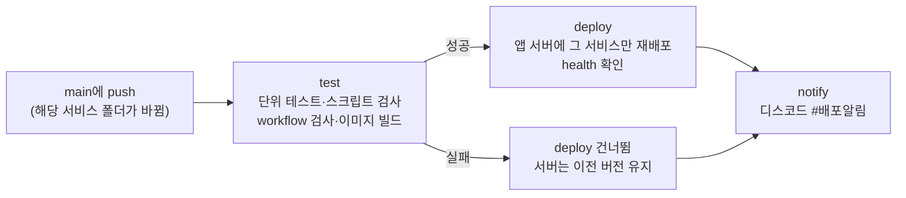

# 파이프라인(CI/CD) 구현 결과 보고서

코드를 main에 올리면 **서비스마다 따로** 자동 테스트 → 이미지 빌드 → 앱 서버에 그 서비스만 다시 배포 → 팀 디스코드 알림이 이어집니다. **테스트가 하나라도 실패하면 배포는 막히고** 서버에는 이전 버전이 그대로 남습니다.
이 문서는 그 구조와 실제 실행 기록입니다. 숫자는 [1. 한눈에](#1-한눈에)에 모아 두었습니다.

## 1. 한눈에

| 항목 | 값 |
|---|---|
| 기간 | 10/6 16:42 ~ 10/12 20:46 (첫 실행부터 마지막 main 배포까지) |
| 전체 실행 | 서비스 workflow 858번 (main·브랜치 push 552번, PR 306번) |
| 성공 / 실패 | 842번 성공 / 12번 실패 / 4번 취소 (성공률 98.1%) |
| main 자동 배포 | 199번 중 195번 성공, 테스트 실패로 막힘 3번, 배포 후 health 확인에서 막힘 1번 |
| 걸린 시간 (중앙값) | 테스트 40초 · 배포 34초 |

- 실패 12번은 모두 **테스트에서 잡혀 배포까지 가지 않았거나**, 배포 뒤 health 확인에 걸려 **성공으로 기록되지 않은** 경우입니다. 자세한 내용은 [6절](#6-실패했던-실행과-원인)에 있습니다.
- 측정: `gh api repos/twlaude/3rd-project-4th-team-project/actions/runs`로 실행 기록 전체를 받아 서비스 workflow 8개만 셌습니다(같은 실행을 다시 돌린 경우는 마지막 시도만). 걸린 시간은 각 job의 시작~끝입니다. 시각은 한국 시간입니다. 아래 실행 기록 링크는 팀이 개발하던 작업 레포(비공개)의 GitHub Actions 기록입니다.

## 2. 흐름



- 서비스 8개(화면·총괄·분류·창구 찾기·검증·문구 작성·가상 발송·장애 스위치)마다 `.github/workflows/<서비스>.yml`이 하나씩 있습니다. 모두 같은 틀입니다.
- 이원민님이 구현했습니다. 배포 접속 정보는 GitHub environment(서비스 이름과 같은 8개)에만 있고, 레포에는 없습니다.

## 3. workflow 한 개의 구조

| 단계 | 언제 도나 | 하는 일 |
|---|---|---|
| 시작 조건 | 그 서비스 폴더, 공통 파일(`contracts/`·`database/`·`docker-compose.yml`·배포 스크립트), 자기 workflow가 바뀐 push·PR | `docs/`와 루트 `README.md`만 바뀌면 돌지 않습니다 |
| test | 모든 브랜치·PR | 서비스 단위 테스트(인터넷 없이), 배포 스크립트 문법·shellcheck 검사, workflow 검사(actionlint), Docker 이미지 빌드 |
| deploy | **test 성공** + main push일 때만 | 바뀐 코드를 앱 서버로 올리고 그 서비스 컨테이너만 다시 빌드·기동, health와 서비스 이름 확인 |
| notify | main push면 항상 | 성공·실패·취소 결과를 팀 디스코드 `#배포알림`으로 보냄 |

배포 단계에서 지키는 것:

| 장치 | 왜 |
|---|---|
| 그 서비스만 다시 띄움(`--no-deps`) | 화면만 고쳤는데 총괄까지 재시작되는 일을 막습니다 |
| 서버 `.env`는 건드리지 않음 | OpenAI 키·데이터 서버 주소는 서버에만 있고, 배포가 덮어쓰지 않습니다 |
| 서버 잠금(최대 300초 대기) | 여러 서비스가 동시에 배포돼도 한 번에 하나씩 반영합니다 |
| health + 서비스 이름 확인(최대 90초) | 컨테이너가 떴어도 응답이 이상하면 배포 실패로 처리합니다 |
| 성공했을 때만 배포 기록 갱신 | 서버의 `.deploy/<서비스>.json`이 마지막 성공 버전을 가리킵니다. 자동 되돌리기(롤백)는 없습니다 |
| 가상 발송을 배포하면 메일함도 함께 띄움 | 가상 발송은 옆의 메일함(Mailpit)이 있어야 동작해서, 이 서비스만 예외로 Mailpit도 같이 띄웁니다(10/11 추가) |

### 실제 workflow에서 핵심 부분 (총괄 `backend.yml` 발췌)

```yaml
on:
  push:
    paths: ['src/backend/**', 'contracts/**', 'database/**', 'docker-compose.yml', ...]
jobs:
  test:                       # 단위 테스트 → 배포 스크립트 검사 → workflow 검사 → 이미지 빌드
    steps:
      - run: python -m pytest -q
      - run: docker compose build backend
  deploy:
    needs: [test]
    if: needs.test.result == 'success' && github.event_name == 'push' && github.ref == 'refs/heads/main'
    environment: backend      # 접속 정보는 이 environment의 시크릿에만 있음
    steps:
      - run: bash scripts/deploy_service.sh backend
  notify:
    needs: [test, deploy]
    if: always() && github.event_name == 'push' && github.ref == 'refs/heads/main'
```

- `deploy`의 `if:` 한 줄이 "테스트가 성공해야만, main에 올린 경우에만 배포"를 정합니다. 테스트가 실패하면 이 조건이 거짓이 되어 배포 job을 건너뜁니다.
- `notify`는 `always()`라 성공·실패와 상관없이 항상 돌고, 결과를 아래 모양으로 팀 디스코드에 보냅니다.

```text
✅ [backend] 테스트·배포 성공
브랜치 `main` · 커밋 `a4ec378` · (올린 사람)
(커밋 메시지 첫 줄)
[실행 로그 보기]
```

## 4. 실제 실행 기록

서비스 8개의 실행 결과입니다. 브랜치·PR 실행(테스트만)과 main 실행(테스트·배포·알림)을 모두 셌습니다.

| 서비스 | 전체 실행 | 성공 | 실패 | main 배포 성공 | 테스트 평균 | 배포 평균 |
|---|---|---|---|---|---|---|
| 화면 (`frontend`) | 167 | 165 | 0 | 38 | 58초 | 38초 |
| 총괄 (`backend`) | 134 | 132 | 0 | 31 | 56초 | 34초 |
| 분류 (`classifier`) | 125 | 123 | 2 | 29 | 36초 | 36초 |
| 창구 찾기 (`locator`) | 79 | 78 | 1 | 17 | 34초 | 34초 |
| 검증 (`verifier`) | 92 | 92 | 0 | 21 | 35초 | 37초 |
| 문구 작성 (`writer`) | 92 | 92 | 0 | 21 | 35초 | 34초 |
| 가상 발송 (`mailer`) | 75 | 75 | 0 | 19 | 35초 | 39초 |
| 장애 스위치 (`chaos`) | 94 | 85 | 9 | 19 | 32초 | 37초 |
| **합계** | **858** | **842** | **12** | **195** | | |

- 화면·총괄의 전체 실행에는 문서 브랜치에서 중간에 취소한 실행이 2번씩(10/12 09:52) 들어 있어서, 성공과 실패를 더한 값보다 2씩 큽니다.
- **main 배포 성공**은 배포 단계가 붙은 뒤(10/8 밤)의 main 실행 중 앱 서버 반영까지 성공한 횟수입니다. 공통 파일(`contracts/`·`docker-compose.yml` 등)이 바뀌면 8개 서비스가 한꺼번에 배포되기 때문에 서비스마다 횟수가 비슷합니다.
- 테스트 시간에는 단위 테스트, 배포 스크립트 검사, workflow 검사, Docker 이미지 빌드가 모두 들어 있습니다. 배포 시간은 성공한 배포 job의 코드 업로드부터 서버에서 이미지를 다시 빌드하고 health가 확인될 때까지입니다.

## 5. 테스트가 실패하면 배포가 막히는지 (10/9 시연)

이원민님이 main에서 **테스트를 일부러 하나 실패시켜** 배포가 막히는지 확인했습니다. 실패 테스트를 넣은 커밋(`534b4e4`)을 올리고, 결과를 본 뒤 되돌리는 커밋(`8c7e449`)을 올렸습니다.

| 시각 | 커밋 | 테스트 | 배포 | 디스코드 알림 | 실행 기록 |
|---|---|---|---|---|---|
| 10/9 08:31 | `db45733` 정상 | 성공 | 성공 | 성공 알림 | [37859908907](https://github.com/twlaude/3rd-project-4th-team-project/actions/runs/37859908907) |
| 10/9 08:39 | `534b4e4` 테스트 일부러 실패 | **실패** (1 failed, 132 passed) | **건너뜀** | 실패 알림 | [37860625419](https://github.com/twlaude/3rd-project-4th-team-project/actions/runs/37860625419) |
| 10/9 08:40 | `8c7e449` 되돌림 | 성공 | 성공 | 성공 알림 | [37860744905](https://github.com/twlaude/3rd-project-4th-team-project/actions/runs/37860744905) |

- 실패한 커밋은 서버로 아예 가지 않았습니다. 실패 전후로 앱 서버의 컨테이너 8개 ID·이미지·시작 시각·상태와 배포 기록이 **모두 같았고**, 되돌린 뒤에야 장애 스위치 서비스만 새 버전으로 바뀌었습니다.
- 시연 말고도 같은 장치가 실제로 두 번 작동했습니다. 10/8 23:49와 10/9 00:06에 장애 스위치 코드가 린트(코드 규칙 검사)를 통과하지 못한 채 main에 올라왔고, 두 번 모두 배포를 건너뛰었습니다([37795618418](https://github.com/twlaude/3rd-project-4th-team-project/actions/runs/37795618418), [37797935415](https://github.com/twlaude/3rd-project-4th-team-project/actions/runs/37797935415)). 린트를 고친 PR #13이 머지된 뒤 정상 배포됐습니다.

## 6. 실패했던 실행과 원인

| 언제 | 서비스 | 어디서 막혔나 | 원인 | 결과 |
|---|---|---|---|---|
| 10/8 23:42 ~ 10/9 00:06 (6번) | 장애 스위치 | 테스트 단계의 린트 검사 | 새로 넣은 파이썬 코드 규칙 검사(ruff) 위반. 브랜치에서 4번, main에서 2번 | main 2번은 배포 건너뜀. PR #13으로 고친 뒤 정상 배포 |
| 10/9 08:39 (1번) | 장애 스위치 | 테스트 단계 | 배포 차단 시연용으로 일부러 넣은 실패 테스트 | 배포 건너뜀, 되돌린 커밋으로 정상 배포 (5절) |
| 10/11 13:28 (1번) | 창구 찾기 | 배포 단계의 health 확인 | 데이터 서버 보안 그룹 규칙이 바뀌어 새 컨테이너가 DB에 붙지 못하고 재시작을 반복 | `deploy: service container failed health check`로 실패 처리하고 실패 알림을 보냄. 자동 되돌리기(롤백)는 없어서, 사람이 데이터 서버 연결을 고친 뒤 다시 배포해 정상화 |
| 10/12 11:58 (2번) | 분류 | 테스트 단계 | 상세 위치를 `주민센터 앞`으로 예상했지만 `동작 상도 주민센터 앞`이 나와 테스트 실패 | 브랜치 push·PR에서 각각 1번 실패, 배포 건너뜀 |
| 10/12 18:13 (2번) | 장애 스위치 | 테스트 단계의 린트 검사 | 테스트 코드의 import 줄 사이에 빈 줄이 빠져 린트(ruff) 검사 실패 | 브랜치 push·PR에서 각각 1번 실패, 배포 건너뜀 |

- 실패 기록 원문: [37794659836](https://github.com/twlaude/3rd-project-4th-team-project/actions/runs/37794659836) · [37794883191](https://github.com/twlaude/3rd-project-4th-team-project/actions/runs/37794883191) · [37795618418](https://github.com/twlaude/3rd-project-4th-team-project/actions/runs/37795618418) · [37797733759](https://github.com/twlaude/3rd-project-4th-team-project/actions/runs/37797733759) · [37797835717](https://github.com/twlaude/3rd-project-4th-team-project/actions/runs/37797835717) · [37797935415](https://github.com/twlaude/3rd-project-4th-team-project/actions/runs/37797935415) · [37860625419](https://github.com/twlaude/3rd-project-4th-team-project/actions/runs/37860625419) · [38111699451](https://github.com/twlaude/3rd-project-4th-team-project/actions/runs/38111699451) · [38197921010](https://github.com/twlaude/3rd-project-4th-team-project/actions/runs/38197921010) · [38197924629](https://github.com/twlaude/3rd-project-4th-team-project/actions/runs/38197924629) · [38228469412](https://github.com/twlaude/3rd-project-4th-team-project/actions/runs/38228469412) · [38228488692](https://github.com/twlaude/3rd-project-4th-team-project/actions/runs/38228488692)
- 테스트 단계의 실패는 서버에 아예 가지 않았습니다. health 확인 실패는 서버에 올라간 뒤 "성공"으로 기록되지 않았고 바로 실패 알림이 갔습니다. 다만 배포는 자동으로 되돌리지 않으므로, 이 경우엔 사람이 원인을 고쳐 다시 배포해야 합니다. 이 건은 코드가 아니라 서버 설정 문제라 사람이 고쳐야 했고, 그 과정은 [배포 및 장애 복구 보고서 7절](deploy_and_recovery.md#7-사람-손이-필요했던-경우)에 있습니다.

## 7. 다시 확인하는 방법

```bash
gh run list --workflow backend.yml --branch main --limit 10   # 서비스별 최근 실행
gh run view <run 번호>                                        # 단계별 결과
```
