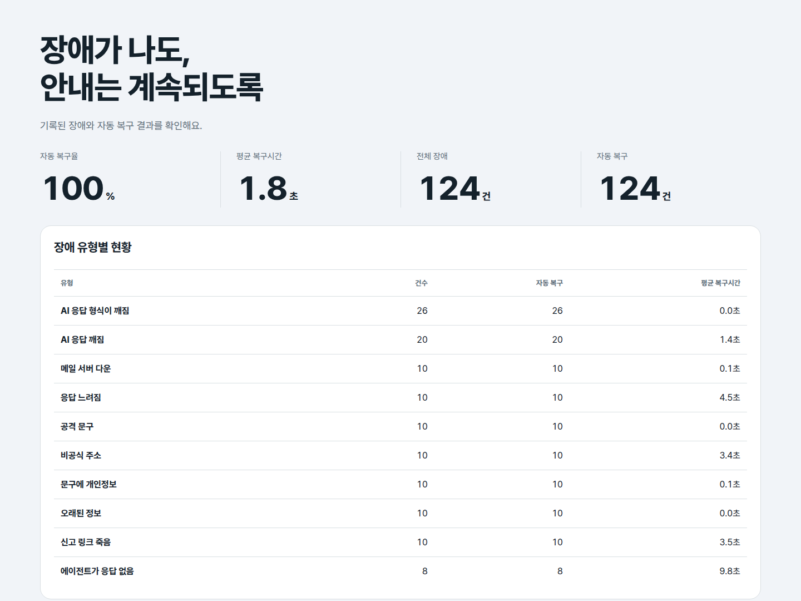
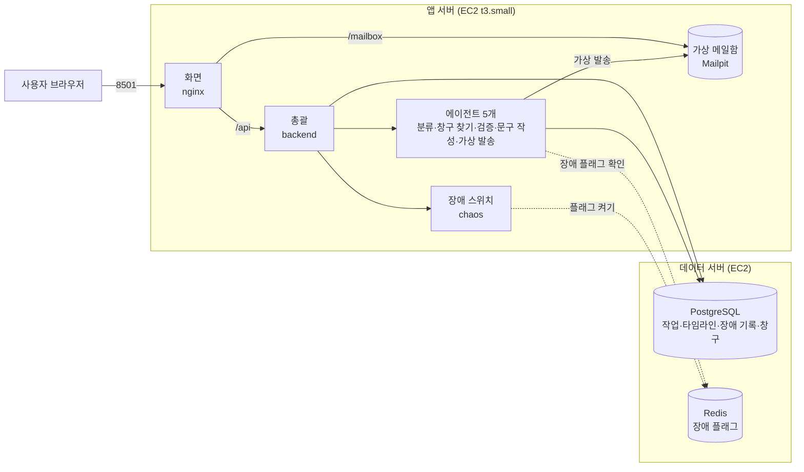
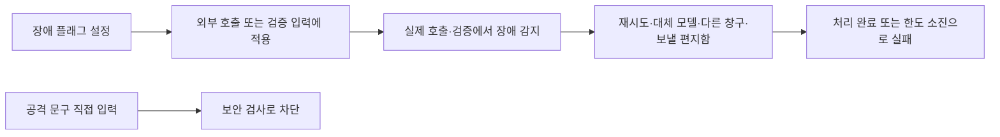
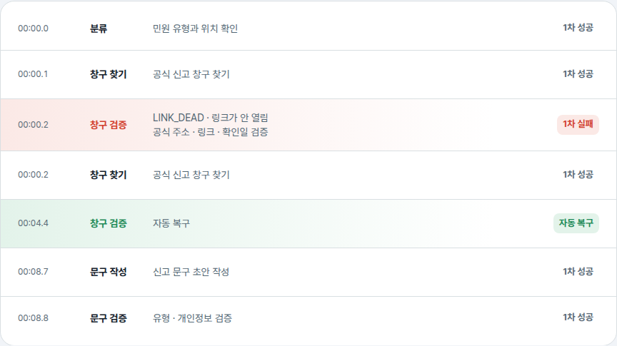

# 배포 및 장애 복구 보고서

생활 민원 길잡이를 서버에 어떻게 올렸는지, 그리고 **일부러 장애를 냈을 때 사람 손 없이 얼마나 복구됐는지 실제로 잰 결과**입니다.
결과는 [1. 결과 요약](#1-결과-요약)과 [6. 실측 결과](#6-실측-결과)에 모아 두었습니다.

## 1. 결과 요약

| 항목 | 값 |
|---|---|
| 언제 | 2026-10-12 14:32:41 ~ 15:05:48 (한국 시간), 커밋 `9d18755` 기준 |
| 장애를 낸 횟수 | 기본 8종 × 10번 + 서비스 다운·DB 끊김 각 5번 + 스트레스 4종 × 5번 = 110번 |
| 장애가 실제로 닿은 횟수 | 110번, 닿지 않은 시험(missed) 0번 |
| 사람 손 없이 처리 | **복구 85번 + 공격 차단 10번 = 95번 / 110번, 자동 복구율 86.36%** |
| 자동으로 처리하지 못함 | **15번**: 링크 죽음·비공식 주소·12초 지연을 각각 3회 연속 적용한 시험이 각 5번 실패 |
| 복구시간 | 복구·차단 95건 기준 **평균 7.12초**, 최대 48.54초(45초 메일 중단). 실패에는 복구시간이 없음 |
| 질문의 끝 | 정상 안내 85번, 의도한 공격 차단 10번, 처리 실패 15번. 원래 작업 상태의 `failed` 25번에는 차단 10번도 들어 있음 |
| 자연 발생 AI 오류 | `LLM_OUTPUT_INVALID` 30건, 30건 모두 대체 모델·규칙으로 자동 복구 |



- 원자료는 [chaos_runs.jsonl](data/chaos_runs.jsonl)(한 줄 = 한 번), 재집계 요약은 [chaos_summary.json](data/chaos_summary.json)입니다. [10/11 원자료](data/archive_1011/)도 보존했습니다.
- 이번 관제 누적 장애는 265건에서 400건으로 늘었습니다. 증가한 135건은 이번 시험의 DB 기록 105건과 자연 발생 AI 오류 30건입니다. DB 끊김 5번은 스크립트가 따로 재며, 위 10/11 화면은 이번 측정 수치를 나타내지 않습니다.

## 2. 서버 구성: 앱 서버와 데이터 서버를 나눈 이유



서비스 8개(화면·총괄·에이전트 5개·장애 스위치)와 가상 메일함은 **앱 서버** 한 대에서, PostgreSQL과 Redis는 **데이터 서버**에서 따로 돌립니다. 나눈 이유는 네 가지입니다.

| 이유 | 설명 |
|---|---|
| 기록 보존 | 앱 서버는 배포할 때마다 컨테이너를 새로 만듭니다. 작업·타임라인·장애 기록이 같은 서버에 있으면 배포나 재시작 때 함께 흔들립니다. 데이터 서버에 두면 앱 서버가 꺼졌다 켜져도 기록과 복구 지표가 그대로 남습니다 |
| 메모리 | 앱 서버는 수업 사양인 t3.small(메모리 2GB)입니다. 서비스 8개와 메일함에 DB까지 올리면 빠듯해서 DB를 덜어 냈습니다 |
| 진짜 장애 시험 | "DB 끊김"을 흉내가 아니라 실제로 낼 수 있습니다. 데이터 서버를 끄지 않고 앱 서버에서 그쪽으로 가는 연결만 잠깐 막습니다 |
| 보안 | 데이터 서버의 DB(5433)·Redis(6379) 포트는 앱 서버 IP 하나에만 열려 있습니다. 앱이 밖으로 여는 포트는 화면 8501번과 같은 화면의 https 주소뿐이고, 나머지는 서버 안에서만 열립니다 |

## 3. docker compose로 띄우는 구조

`docker-compose.yml` 한 파일로 내 컴퓨터와 서버를 모두 띄웁니다. 차이는 `.env` 값 몇 개뿐입니다.

| 서비스 | 포트 | 하는 일 | 밖으로 열림 |
|---|---|---|---|
| frontend | 8501 | 화면(React + nginx). 시민 화면 `/`와 관리자 화면 `/admin/`을 함께 서빙하고, `/api`는 총괄로, `/mailbox`는 가상 메일함으로 전달 | 예 (서버에서 `FRONTEND_BIND=0.0.0.0`) |
| backend | 8000 | 총괄. 에이전트에게 순서대로 일을 넘기고 기록·지표 계산 | 아니요 |
| classifier · locator · verifier · writer · mailer | 8010 · 8020 · 8030 · 8040 · 8060 | 에이전트 5개 | 아니요 |
| chaos | 8050 | 장애 스위치(장애 켜기·끄기, 레드팀) | 아니요 |
| mailpit | 1025 · 8025 | 가상 메일함. 받기만 하고 밖으로 보내지 않음 | 아니요 |
| postgres · redis | 5432 · 6379 | 내 컴퓨터에서만 같이 뜸(`COMPOSE_PROFILES=local`) | 아니요 |

- **같은 파일, 두 가지 실행**: 내 컴퓨터는 `COMPOSE_PROFILES=local`이라 PostgreSQL·Redis까지 11개가 뜹니다. 앱 서버는 이 값을 비우고 `DATABASE_URL`·`REDIS_URL`로 데이터 서버에 붙어 9개만 뜹니다.
- **스스로 다시 켜짐**: 모든 서비스가 `restart: unless-stopped`입니다. 컨테이너가 죽으면 Docker가 다시 켭니다.
- **건강 검사**: 파이썬 서비스는 모두 `/health`를 갖고 있고, 화면은 총괄이 healthy가 된 뒤에 뜹니다.
- **비밀값**: OpenAI 키와 데이터 서버 주소는 서버의 `.env`에만 있고, 배포할 때도 덮어쓰지 않습니다.

배포는 main에 코드를 올리면 GitHub Actions가 바뀐 서비스만 테스트하고 앱 서버에 다시 올립니다. 자세한 내용은 [파이프라인(CI/CD) 구현 결과 보고서](cicd.md)에 있습니다.

## 4. 장애를 내는 방법

| 장애 | 실제로 일어나는 일 | 알아채는 쪽 · 복구 길 |
|---|---|---|
| AI 답 깨짐 (`llm_invalid`) | 첫 모델을 실제로 부를 때 JSON을 쓰지 말라고 지시 | 답 형식 검사 → 대체 모델 → 규칙·템플릿. 모델이 지시를 무시해 정상 답을 주면 장애가 닿지 않을 수 있음 |
| 링크 죽음 (`link_dead`) | 검증할 주소의 호스트에 `.invalid`를 붙여 실제 DNS 조회 실패 | 링크 검사 → 그 창구를 빼고 다시 찾기 |
| 비공식 주소 (`not_official`) | 검증 입력을 공식 도메인이 아닌 주소로 바꿈 | 공식 도메인 검사 → 그 창구를 빼고 다시 찾기 |
| 오래된 정보 (`stale_info`) | 검증 입력의 확인일을 2020-01-01로 바꿈 | 확인일 검사 → 안내에 "확인 필요" 표시 |
| 문구에 개인정보 (`pii_leak`) | 검증할 문구에 시험용 전화번호를 넣음 | 개인정보 검사 → 지우고 다시 쓰기 |
| 공격 문구 (`injection`) | 플래그 없이 실제 공격 문장을 질문 앞에 넣음 | `security.is_injection` 검사 → 차단하고 기록 |
| 메일 서버 다운 (`mail_down`) | Docker 소켓으로 Mailpit을 실제 중단하고 정해진 시간 뒤 다시 켬 | SMTP 실패 → 재시도 → 보낼 편지함에 보관 → 자동 재발송 |
| 느려짐 (`delay`) | 에이전트가 실제로 12초 기다림 | 총괄의 10초 제한 → 3초·6초 기다리며 재시도 |
| 서비스 다운 | `chaos_infra.sh`가 대상 컨테이너를 5초 멈췄다 켬 | 총괄의 응답 오류 → 3초·6초 기다리며 재시도 |
| DB 끊김 | `chaos_infra.sh`가 DB로 가는 연결을 방화벽으로 5초 차단 | 연결 실패 → 1·2·3·4초 간격으로 재연결 |

> 위 표는 측정 당시(커밋 `9d18755`) 방식입니다. 측정 뒤 장애를 더 실제에 가깝게 내도록 세 가지를 바꿨고, 바뀐 방식으로 110번을 다시 재지는 않았습니다. ① AI 답 깨짐: 지시를 덧붙이지 않고 "산문으로만 답하라"는 지시로 통째로 바꿔서 실제로 JSON 해석이 실패합니다. ② 문구에 개인정보: 검증 입력이 아니라 문구 작성 에이전트가 만든 문구에 번호를 넣고, 작성 단계의 개인정보 검사가 지웁니다. ③ 시간 제한: AI 호출은 한 번에 10초·합쳐 13초, 에이전트 호출은 15초로 늘렸고 장애 실험실의 지연은 20초입니다. 지금 방식은 [설계서 8절](../DESIGN.md#8-실제-호출에-장애를-주입하는-방법)에 있습니다.



- 플래그는 기본 한 번 적용되며, `params.repeat=3`이면 같은 장애가 연속 세 번 적용됩니다. 재시도·재계획 횟수가 부족하면 실패할 수 있습니다.
- 메일은 발송 요청이 끝나도 보낼 편지함에서 계속 재시도합니다. 총괄이 5초마다 발송 결과를 확인해 타임라인·작업 상태·복구 시각에 반영합니다.



## 5. 어떻게 쟀나

측정은 `scripts/chaos_measure.py` 하나로 했습니다. 아래 명령의 기본 횟수는 110번이며, 실행할 때마다 원자료와 요약 파일을 새로 씁니다.

```bash
python3 scripts/chaos_measure.py --base http://127.0.0.1:8000 --infra --out docs/reports/data
```

| 구분 | 횟수 | 한 번의 시험 |
|---|---|---|
| 기본 장애 8종 | 각 10번, 80번 | 가로등·도로·쓰레기 질문을 돌아가며 넣고 장애 기록과 작업의 최종 상태를 읽습니다. 메일은 정상 안내를 만든 뒤 Mailpit을 20초 중단하고 발송을 요청합니다 |
| 서비스 다운 · DB 끊김 | 각 5번, 10번 | 중단·차단을 확인한 뒤 질문을 넣습니다. 서비스는 분류·창구 찾기·검증·문구 작성을 돌아가며 멈춥니다 |
| 스트레스 변형 4종 | 각 5번, 20번 | 링크 죽음·비공식 주소를 각각 3회 연속, 12초 지연을 3회 연속 적용하고 메일 중단은 45초로 늘립니다 |

- **닿음(hit)** = 해당 장애 기록에 `detected_at`이 있는 경우입니다. DB 끊김은 차단을 확인한 시각을 스크립트가 기록합니다. 닿지 않은 시험은 `missed`로 남깁니다.
- **자동 복구** = 장애가 닿고 사람 개입 없이 작업이 `success`·`needs_user`·`blocked`로 끝나거나, `failed`여도 `INJECTION_BLOCKED` 또는 장애 기록 `blocked`로 의도한 공격 차단이 확인된 경우입니다. 표에서는 복구와 차단을 별도로 나누며, 복구율 분자는 둘을 더합니다. 메일은 실제 발송 성공 기록까지 있어야 하며 복구 기록을 최대 120초 기다립니다.
- **복구시간** = `recovered_at − detected_at`입니다. 복구된 기록 중 시간이 있는 것만 평균·최대에 넣습니다. DB 끊김만 차단 확인부터 질문 처리가 끝날 때까지 재므로 시간의 범위가 다릅니다.
- **자동 복구율** = 자동 복구 건수 ÷ 장애가 실제로 닿은 건수입니다. 관리자 화면의 관제 대시보드와 같은 계산입니다.
- 이번 시험의 집계와 누적 관제 수치는 대상이 다릅니다. 관제에는 과거 기록·닿지 않은 주입 기록·자연 발생 장애도 남고, DB 끊김은 별도 측정입니다. 실패는 닿았지만 자동 복구 조건을 충족하지 못한 횟수이며, `missed`와 나눠 표에 남깁니다.

## 6. 실측 결과

| 장애 · 조건 | 횟수 | 닿음 | 복구 | 차단 | 실패 | missed | 평균 시간 | 최대 시간 |
|---|---|---|---|---|---|---|---|---|
| AI 답 깨짐 · 분류 | 10 | 10 | 10 | 0 | 0 | 0 | 0.02초 | 0.04초 |
| 링크 죽음 · 검증 | 10 | 10 | 10 | 0 | 0 | 0 | 3.05초 | 5.18초 |
| 오래된 정보 · 검증 | 10 | 10 | 10 | 0 | 0 | 0 | 0.02초 | 0.03초 |
| 개인정보 · 문구 검증 | 10 | 10 | 10 | 0 | 0 | 0 | 0.11초 | 0.13초 |
| 비공식 주소 · 검증 | 10 | 10 | 10 | 0 | 0 | 0 | 3.02초 | 5.19초 |
| 공격 문구 · 총괄 | 10 | 10 | 0 | 10 | 0 | 0 | 0.02초 | 0.04초 |
| 12초 지연 · 분류 | 10 | 10 | 10 | 0 | 0 | 0 | 4.68초 | 5.25초 |
| 메일 20초 중단 | 10 | 10 | 10 | 0 | 0 | 0 | 21.77초 | 23.43초 |
| 서비스 5초 중단 | 5 | 5 | 5 | 0 | 0 | 0 | 7.47초 | 9.24초 |
| DB 연결 5초 차단 | 5 | 5 | 5 | 0 | 0 | 0 | 15.97초 | 18.82초 |
| 스트레스: 링크 죽음 3회 연속 | 5 | 5 | 0 | 0 | 5 | 0 | - | - |
| 스트레스: 비공식 주소 3회 연속 | 5 | 5 | 0 | 0 | 5 | 0 | - | - |
| 스트레스: 12초 지연 3회 연속 | 5 | 5 | 0 | 0 | 5 | 0 | - | - |
| 스트레스: 메일 45초 중단 | 5 | 5 | 5 | 0 | 0 | 0 | 46.53초 | 48.54초 |
| **전체** | **110** | **110** | **85** | **10** | **15** | **0** | **7.12초** | **48.54초** |

※ AI 답 깨짐의 0.02초는 측정 당시 내부 복구가 끝난 뒤 감지·복구 시각을 한꺼번에 기록했기 때문입니다. 측정 뒤 첫 실패 시각부터 기록하도록 고쳐서, 지금은 대체 모델을 부르는 1~3초가 복구시간에 들어갑니다.

- 자동 복구율은 (복구 85 + 차단 10) ÷ 110 = **86.36%**입니다. 전체 평균은 복구·차단 95건의 기록 시간이며, 실패 15건은 분모에서 빼지 않고 시간만 계산하지 않습니다. missed는 0건입니다.
- **차단 범주 수정**: 측정기는 처음에 공격 차단의 작업 상태 `failed`만 보고 10건을 미복구로 분류했습니다. `INJECTION_BLOCKED`와 장애 기록 `blocked`를 확인해 기존 JSONL을 `resummarize`로 다시 집계했습니다. 재측정은 없으며, JSONL의 당시 `result_ok`·`recovered` 값과 [수정 전 요약·로그](data/archive_1012_raw/)도 그대로 보존했습니다.
- **100%인 기본 항목의 이유**: AI 답 깨짐은 기본 모델 → 대체 모델 → 규칙의 세 단계가 있습니다. 링크 죽음·비공식 주소·지연은 한 번 적용 후 정상 경로가 남고, 오래된 정보는 경고하며 안내, 개인정보는 다시 쓰기, 공격 문구는 정해진 검사로 차단합니다.
- **100%인 메일·인프라 항목의 조건**: 메일은 중단 뒤 다시 켜지고 보낼 편지함이 유지돼 재발송됩니다. 서비스·DB도 5초 뒤 돌아와 재시도 시간 안에 처리됐습니다. 중단이 더 길거나 편지함이 사라지는 경우까지 보장하는 수치가 아닙니다.
- **자연 발생 AI 복구**: 30건 중 30건이 복구됐고 기록상 평균은 0.02초입니다. 주입한 AI 답 깨짐도 평균 0.02초인데, 모두 내부 대체 호출이 끝난 뒤 감지·복구 시각이 기록되어 실제 AI 호출 시간은 포함하지 않습니다.
- **스트레스의 한계가 드러난 15건**: 링크·주소는 재계획 2회를 소진했고, 지연은 10초 제한에 세 번 걸려 같은 단계의 시도 3회를 소진했습니다. 복구하지 못한 작업은 다음과 같으며, 실패를 빼거나 다시 실행하지 않았습니다.

| 실패 조건 | run | job ID | 원인 |
|---|---|---|---|
| 스트레스: 링크 죽음 3회 연속 | 1 | `job-55284f34527f4bacaaf24950b691c7b9` | LINK_DEAD · 재계획 한도 소진 |
| 스트레스: 링크 죽음 3회 연속 | 2 | `job-9dcdcd0962c0425dbeec9c026fad2a7d` | LINK_DEAD · 재계획 한도 소진 |
| 스트레스: 링크 죽음 3회 연속 | 3 | `job-bd1653d80bc54a94b363d3d37a9a8bdb` | LINK_DEAD · 재계획 한도 소진 |
| 스트레스: 링크 죽음 3회 연속 | 4 | `job-fbb0e3b41738474ab2aebe0a283eceb7` | LINK_DEAD · 재계획 한도 소진 |
| 스트레스: 링크 죽음 3회 연속 | 5 | `job-7b7d5301c4ea41e3adc838784e3c44ff` | LINK_DEAD · 재계획 한도 소진 |
| 스트레스: 비공식 주소 3회 연속 | 1 | `job-17ecc14b1b6a4c66a26b542a4da9be9d` | NOT_OFFICIAL · 재계획 한도 소진 |
| 스트레스: 비공식 주소 3회 연속 | 2 | `job-1767c97795ea40ef8613ea9d5ec03b22` | NOT_OFFICIAL · 재계획 한도 소진 |
| 스트레스: 비공식 주소 3회 연속 | 3 | `job-64b1dfa33208409197ad2b3fa0376320` | NOT_OFFICIAL · 재계획 한도 소진 |
| 스트레스: 비공식 주소 3회 연속 | 4 | `job-a8cabfaed6124573845af628e32ace69` | NOT_OFFICIAL · 재계획 한도 소진 |
| 스트레스: 비공식 주소 3회 연속 | 5 | `job-9eaeccf2340e4fbeaba323f51d2862ff` | NOT_OFFICIAL · 재계획 한도 소진 |
| 스트레스: 12초 지연 3회 연속 | 1 | `job-a0406383c26244a0910a35c46bbd5023` | SERVICE_UNAVAILABLE · 10초 제한·시도 한도 소진 |
| 스트레스: 12초 지연 3회 연속 | 2 | `job-1488bfc863284a3191e735dabb213fa4` | SERVICE_UNAVAILABLE · 10초 제한·시도 한도 소진 |
| 스트레스: 12초 지연 3회 연속 | 3 | `job-63333a5143cc4e0aa40f579d9c40611e` | SERVICE_UNAVAILABLE · 10초 제한·시도 한도 소진 |
| 스트레스: 12초 지연 3회 연속 | 4 | `job-25c4686782024703a4947a30ba263781` | SERVICE_UNAVAILABLE · 10초 제한·시도 한도 소진 |
| 스트레스: 12초 지연 3회 연속 | 5 | `job-da9d6a3d9b7d42b9b29b7a4edf21a57e` | SERVICE_UNAVAILABLE · 10초 제한·시도 한도 소진 |

7절의 10/11 기록은 이번 재측정 대상 밖의 이전 기록이며, 이번 실패 수는 위 표의 15건입니다.

## 7. 사람 손이 필요했던 경우

사람 손이 필요한 경우는 세 가지였습니다.

**① 설계상 사람에게 묻는 경우 — 위치가 빠진 설명**
"가로등이 꺼졌어요"처럼 어디인지 없는 설명은 창구를 정할 수 없어서 추가 질문 카드를 띄웁니다. 사용자가 답하면 이어서 진행하고, 두 번 물어도 부족하면 "확인 필요"를 붙여 상위 창구로 안내합니다. 장애가 아니라 정상 흐름이라 복구율 계산에는 넣지 않았습니다.

**② 측정 중 자동으로 복구하지 못한 경우 — 15번 (전부 같은 장애를 3회 연속 준 스트레스 시험)**
한 번 터지는 장애 95번(기본 80 + 서비스 다운·DB 끊김 10 + 45초 메일 중단 5)은 모두 사람 손 없이 처리됐습니다(정상 안내 85번, 공격 문구 10번은 의도대로 차단). 반면 링크 죽음·비공식 주소·12초 지연을 각각 3회 연속 준 15번은 재계획 2회·재시도 3회가 바닥나 작업이 실패로 끝났고, 이때는 사용자에게 "지금은 안내할 수 없다"고 알리는 것 외에 사람이 봐야 합니다. 세부는 6절 실패 사례 표에 있습니다.

**③ 배포·서버 설정 문제 — 통합하면서 사람이 고친 것 (10/11)**
자가 치유는 "실행 중에 생긴 고장"을 다시 시도하거나 다른 길로 돌아가는 것입니다. 설정이 처음부터 틀린 경우는 몇 번을 다시 해도 같으므로 사람이 고쳐야 했습니다.

| 무엇이 문제였나 | 어떻게 알았나 | 어떻게 고쳤나 |
|---|---|---|
| 데이터 서버의 보안 그룹 규칙이 다른 실습용으로 바뀌어 앱 서버가 DB에 못 붙음 | 새로 배포한 창구 찾기가 시작하자마자 DB 연결 시간 초과로 재시작을 반복 | 보안 그룹에 앱 서버 IP 규칙을 다시 넣고, 실제 DB 포트(5433)로 앱 서버 설정을 맞춤 |
| 데이터 서버 DB에 표가 하나도 없음 | 질문 접수(작업 저장)부터 실패 | `database/schema.sql`을 한 번 실행해 표를 만듦. 배포가 DB 구조를 자동으로 바꾸지 않게 한 것은 의도한 설계입니다 |
| 가상 메일함(Mailpit)이 앱 서버에 떠 있지 않음 | 가상 발송이 전부 메일 서버 연결 실패 | 서비스별 배포가 가상 발송만 띄우고 옆의 Mailpit은 띄우지 않았음. Mailpit을 띄우고, 가상 발송을 배포할 때 Mailpit도 함께 띄우도록 배포 스크립트를 고침 |


## 8. 한계

| 한계 | 설명 |
|---|---|
| 앱 서버가 한 대 | 컨테이너 하나가 죽는 것은 다시 켜서 복구하지만, 앱 서버 자체가 꺼지면 복구할 방법이 없습니다 |
| 같은 장애가 이어지면 깨짐 | 장애를 한 번만 넣으면 전부 처리되지만, 같은 장애를 3회 연속 넣으면 재계획 2회·재시도 3회가 바닥나 실패합니다(6절 스트레스 시험 15/15 실패). 재시도 횟수를 늘리는 것보다 "지금은 안내할 수 없다"를 빨리 알리는 쪽이 낫다고 보고, 횟수는 그대로 두었습니다. AI 서비스가 몇 분씩 멈추는 경우는 규칙·템플릿 결과로만 안내하게 됩니다 |
| 보낼 편지함이 컨테이너 안에 있음 | 가상 발송의 보낼 편지함은 컨테이너 안 파일이라, 그 컨테이너를 새로 만들면(재배포) 아직 못 보낸 메일이 사라집니다 |
| 측정 규모 | 기본 장애는 종류마다 10번, 인프라·스트레스 변형은 5번씩, 한 번에 33분 동안 잰 값입니다. 오래 운영하며 쌓인 통계는 아닙니다 |

